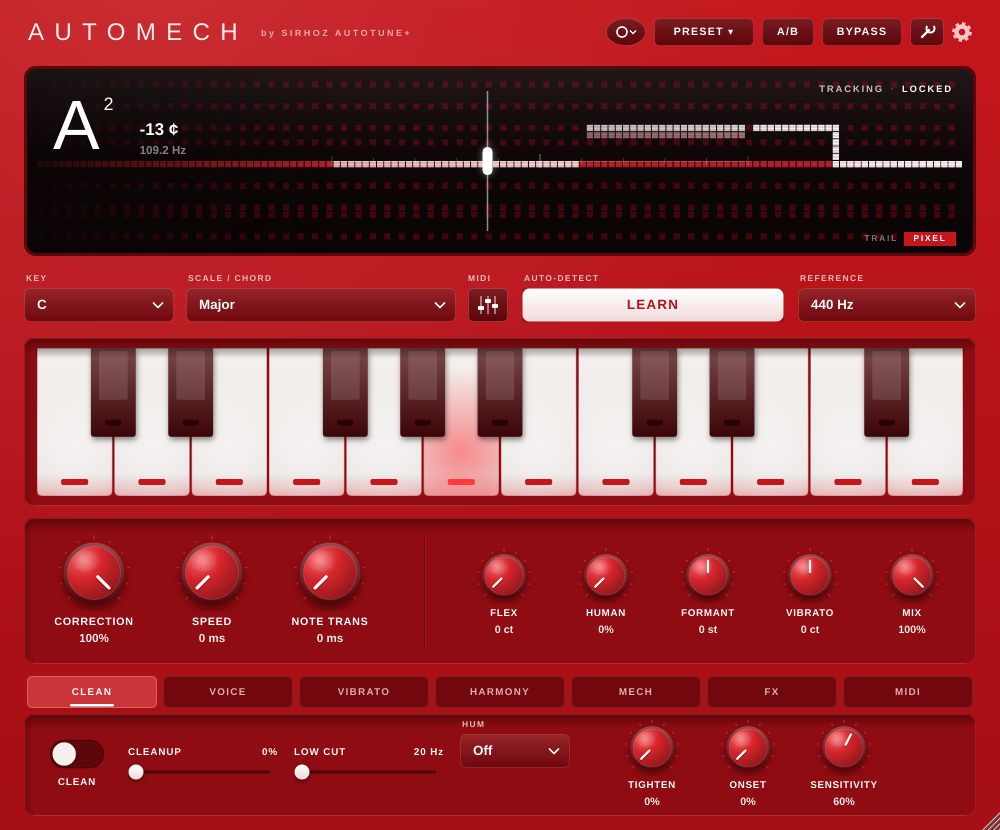

# AUTOMECH by Sirhoz AutoTune+

Real-time vocal pitch correction with a mechanical / robotic voice mode and a retro pixel visualizer.
VST3 + Standalone (plus AU on macOS), built with JUCE 8 and CMake.



## Features

- **Pitch detection**: YIN on a decimated (~12 kHz) copy of the input, with sensitivity, voice-type range and a TRACKING / LOCKED readout.
- **Pitch correction**: pitch-synchronous overlap-add (TD-PSOLA style). Formants stay in place by default, or move with the pitch when *Formant Preserve* is off.
- **Key and scale**: 12 keys, 11 scales plus *Custom* (click keys on the keyboard), a reference of 415 to 466 Hz, and **LEARN**, which listens for 5 s and picks the key with Krumhansl key profiles.
- **Main knobs**: Correction, Speed, Note Trans, Flex, Human, Formant, Vibrato, Mix.
- **Tabs**
  - **CLEAN**: low cut, hum notch (50/60 Hz plus harmonics), cleanup gate, Tighten, Onset, Sensitivity.
  - **VOICE**: voice type, formant preserve.
  - **VIBRATO**: depth, rate, delay, shape.
  - **HARMONY**: 3 voices at scale-step intervals, with level and pan.
  - **MECH**: Robot (monotone on the key root), Ring mod, Comb.
  - **FX**: drive, stereo width.
  - **MIDI**: a held MIDI note sets the target pitch class.
- **Pixel visualizer** inside the pitch screen. Click **PIXEL** to turn it on or off, and click the screen to cycle TRAIL, SPECTRUM and SCOPE.
- **Presets**: Natural, Hard Tune, Robot Voice, Soft Pop, Choir Stack. You can also save and load your own `.amech` files, and A/B compare.
- Real-time safe: no allocations in `processBlock`, smoothed parameters, `ScopedNoDenormals`, and correct latency reporting (about 25 ms).

## Build

Requirements: CMake 3.22 or newer and a C++17 compiler. JUCE 8.0.4 is downloaded automatically.

```bash
cd AutoMech
cmake -B build -DCMAKE_BUILD_TYPE=Release
cmake --build build --config Release --parallel
```

Plugins end up in `build/AutoMech_artefacts/Release/` (`VST3/AutoMech.vst3`, `Standalone/`, `AU/` on macOS).

- **Windows**: Visual Studio 2022. Copy `AutoMech.vst3` to `C:\Program Files\Common Files\VST3`.
- **macOS**: Xcode command line tools. For a universal binary, add `-DCMAKE_OSX_ARCHITECTURES="arm64;x86_64"`. Copy the plugins to `~/Library/Audio/Plug-Ins/VST3` and `~/Library/Audio/Plug-Ins/Components`. Unsigned builds may need `xattr -cr AutoMech.vst3`.
- **Linux**: install `libasound2-dev libx11-dev libxrandr-dev libxinerama-dev libxcursor-dev libfreetype-dev libfontconfig1-dev` first.

To build against a local JUCE checkout instead of downloading it, add `-DAUTOMECH_JUCE_DIR=/path/to/JUCE`.

GitHub Actions (`.github/workflows/automech.yml`) builds Windows and macOS, runs the DSP tests, and uploads the plugins as artifacts.

## Tests and tools

```bash
cmake -B build -DAUTOMECH_BUILD_TOOLS=ON
cmake --build build --target AutoMechTools
./build/AutoMechTools_artefacts/Release/AutoMechTools test
./build/AutoMechTools_artefacts/Release/AutoMechTools snapshot gui.png 0
```

`test` renders out-of-tune test vowels offline and measures the output pitch with an independent full-rate YIN, so the result does not depend on the plugin's own detector. Cases covered: correction to the nearest scale note, Correction 0 %, Bypass, Mech Robot, retune speed, and stability with everything turned on.

`snapshot` renders the editor to a PNG (`0` trail, `1` spectrum, `2` scope).

## Architecture

```
Source/
  Identity.h             plugin and developer name (change the branding here)
  Parameters.h           parameter IDs, choice lists, voice ranges
  PluginProcessor.*      APVTS, audio graph, control-rate pitch logic, presets, A/B, learn
  PluginEditor.*         layout (1000 x 830 design units, scaled with a fixed aspect ratio)
  DSP/
    PitchDetector.*      YIN + median filter, on a decimated signal
    PsolaShifter.*       shared input history, pitch epochs, 4 grain voices (main + 3 harmonies)
    ScaleQuantizer.h     scale masks, nearest note with hysteresis, scale steps
    Biquad.h             RBJ filters (low cut, hum notches, anti-alias)
  UI/
    Theme.h              colour palette and panel drawing
    AutoMechLookAndFeel  glossy red knobs, sliders, dropdowns, buttons, switches
    Controls.*           labelled knob / combo / switch / slider, tab strip, pages
    PitchDisplay.*       black glass screen: note, cents, Hz, needle, status
    PixelVisualizer.*    128-column pixel grid: pitch trail, FFT spectrum, scope
    PianoKeyboard.*      1.5 octave keyboard with scale glow and click-to-toggle
Tools/AutoMechTools.cpp  offline DSP tests + GUI snapshot
```

**Signal flow:**

1. The input is mixed to mono and goes through the CLEAN chain (when it's on).
2. The pitch detector and the PSOLA input buffer receive the cleaned signal.
3. Every 32 samples the control logic computes the target pitch: scale note (or MIDI), then glide, human, flex, onset, vibrato, robot and speed smoothing. From this it sets the shift ratios for the main voice and the harmony voices.
4. The grains are rendered, then pass through mech, drive and width.
5. The result is mixed with the latency-aligned dry signal and the bypass crossfade.

The audio thread passes data to the GUI through atomics (telemetry) and an `AbstractFifo` (visualizer audio).
