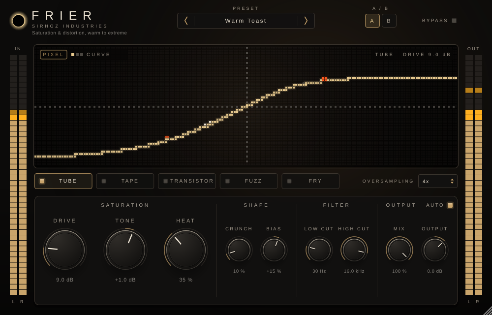
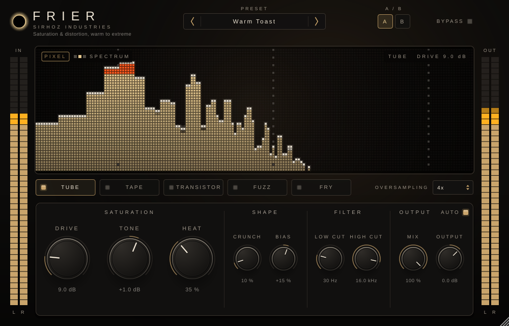
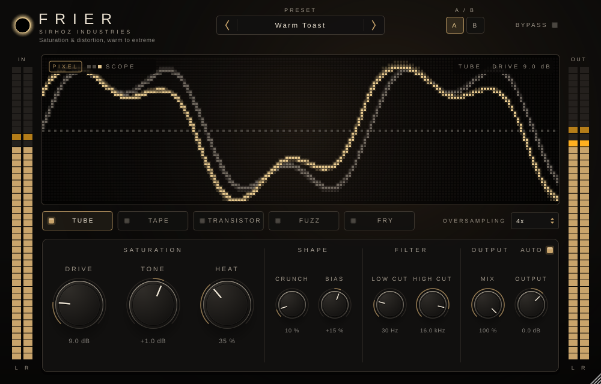

# FRIER

Saturation and distortion that "fries" the signal from warm to extreme.
A JUCE 8 (C++17) VST3 effect plugin plus a Standalone app, by **Sirhoz Industries**.



| Spectrum | Scope |
|---|---|
|  |  |

## Architecture

```
input ─┬─────────────── dry delay (= oversampler latency) ────────────────┐
       │                                                                   │
       └─ LOW CUT ─ CRUNCH pre-emphasis ─▶ upsample ─▶ SaturationEngine ─▶ downsample
                                           (1/2/4/8x)   DRIVE·HEAT·BIAS·model
                                                                           │
          ◀─ DC blocker ◀─ HIGH CUT ◀─ TONE tilt ◀─ CRUNCH de-emphasis ◀───┘
          │
          └─ auto gain ─▶ MIX (with delayed dry) ─▶ OUTPUT ─▶ bypass crossfade ─▶ out
                                                      │
                     meters (atomics) + lock-free FIFO ─▶ GUI (meters, pixel visualizer)
```

- **Fixed internal chunks.** `processBlock` works in chunks of at most 256 samples, so any host block size is handled with buffers allocated once in `prepareToPlay`. Filter coefficients follow their smoothed parameters once per chunk.
- **Oversampling.** `Oversampler` builds one `juce::dsp::Oversampling` instance per factor up front (FIR equiripple half-band, integer latency). Switching factor on the audio thread is allocation-free. It updates the dry delay and calls `setLatencySamples`.
- **Saturation models.** In `SaturationEngine`, each model is a stateless waveshaper `shape()`. The GUI calls the same function to draw the transfer curve.
  - **TUBE:** asymmetric tanh (even harmonics)
  - **TAPE:** algebraic soft clip, with hysteresis-style memory and a one-pole HF roll-off
  - **TRANSISTOR:** symmetric clipper whose knee hardens with HEAT (odd harmonics)
  - **FUZZ:** partial rectification into a heavy asymmetric clip, then an envelope gate with a slow decay
  - **FRY:** triangle wavefolder, then 16-to-4-bit reduction

  Model changes crossfade over 12 ms. DRIVE, HEAT and BIAS are smoothed at the oversampled rate.
- **Delay-compensated dry path.** With MIX at 0 % or in bypass, the output is the input delayed by exactly the reported latency. The bypass parameter is exposed to the host and crossfades over 20 ms.
- **Auto gain.** A slow (~350 ms) RMS follower matches the wet level to the input level, limited to −30…+12 dB. It holds its gain through silence.
- **GUI data.** Peak meters are published through atomics. A mono dry/wet stream goes to the GUI through `VisualizerFifo`, a single-producer/single-consumer `juce::AbstractFifo`.
- **GUI.** Everything is laid out in 1000 × 640 design units inside `MainView`. The editor scales that view with an `AffineTransform`, so resizing keeps the fixed aspect ratio and all drawing stays vector-sharp. The pixel visualizer renders into a software image at physical resolution, so its pixels stay crisp at any scale.

## File tree

```
frier/
├── CMakeLists.txt                 JUCE 8 via FetchContent; VST3 + Standalone; optional tests
├── Source/
│   ├── Identity.h                 name / tagline; manufacturer comes from CMake (one constant)
│   ├── Parameters.h/.cpp          APVTS layout, parameter IDs, units, factory presets
│   ├── PluginProcessor.h/.cpp     signal flow, latency, presets, A/B, state
│   ├── PluginEditor.h/.cpp        scaled MainView: header, display, model row, knob panel
│   ├── dsp/
│   │   ├── SaturationEngine.h/.cpp   5 models, smoothing, model crossfade
│   │   ├── Oversampler.h/.cpp        1x/2x/4x/8x, pre-built, integer latency
│   │   ├── Filters.h                 RBJ biquads (HP, LP, high shelf), DC blocker
│   │   └── VisualizerFifo.h          lock-free audio → GUI FIFO
│   └── gui/
│       ├── Palette.h                 colours sampled from the reference GUI
│       ├── FrierLookAndFeel.h/.cpp   knob, LED, buttons, combo boxes, fonts
│       ├── Knob.h/.cpp               parameter-bound rotary control
│       ├── LevelMeter.h/.cpp         segmented stereo peak meter
│       ├── ModelSelector.h/.cpp      TUBE / TAPE / TRANSISTOR / FUZZ / FRY
│       └── PixelVisualizer.h/.cpp    8-bit CURVE / SPECTRUM / SCOPE display
├── Tests/FrierTests.cpp           offline DSP checks + editor PNG snapshots
└── docs/                          screenshots produced by FrierTests
.github/workflows/frier-build.yml  Windows + macOS VST3 build, uploaded as artifacts
```

## Controls

| Control | Range | Notes |
|---|---|---|
| DRIVE | 0 – 48 dB | gain into the saturator |
| TONE | −6 – +6 dB | tilt EQ around 900 Hz |
| HEAT | 0 – 100 % | harmonic amount / model character |
| CRUNCH | 0 – 100 % | +15 dB pre-emphasis at 1.8 kHz, −9 dB de-emphasis after |
| BIAS | −100 – +100 % | DC offset into the shaper (asymmetry); removed afterwards |
| LOW CUT | 20 – 500 Hz | 12 dB/oct, before the saturator |
| HIGH CUT | 2 – 20 kHz | 12 dB/oct, after the saturator |
| MIX | 0 – 100 % | dry path is latency compensated |
| OUTPUT | −24 – +12 dB | |
| AUTO | on/off | auto gain |
| OVERSAMPLING | 1x / 2x / 4x / 8x | latency reported to the host |

Knobs support vertical drag, Shift+drag for fine adjustment, the mouse wheel (Shift for fine), and double-click to reset.
Click the display, or its **PIXEL** tag, to cycle the visualizer modes.
**A / B** keeps two independent settings to compare.

Presets: *Warm Toast*, *Crispy Tape*, *Deep Fry*, *Fuzz Pedal*, *Bit Burn*.

## Building

Requirements: CMake ≥ 3.22, a C++17 compiler, and Git, which FetchContent uses to download JUCE 8.0.9.

```bash
cmake -S frier -B frier/build -DCMAKE_BUILD_TYPE=Release
cmake --build frier/build --config Release --target FRIER_VST3 FRIER_Standalone
```

The outputs land in `frier/build/FRIER_artefacts/Release/VST3/FRIER.vst3` and `.../Standalone/`.

- **macOS universal binary:** add `-DCMAKE_OSX_ARCHITECTURES="arm64;x86_64"`.
- **Windows:** the default Visual Studio generator works as is.
- **Linux:** install JUCE's dependencies first, e.g. `libasound2-dev libfreetype-dev libfontconfig1-dev libx11-dev libxrandr-dev libxinerama-dev libxcursor-dev libxext-dev libgl1-mesa-dev`.
- **Using an existing JUCE checkout:** add `-DFETCHCONTENT_SOURCE_DIR_JUCE=/path/to/JUCE`.
- **Changing the developer name:** add `-DFRIER_MANUFACTURER="..."`. That one value feeds the plugin metadata and the GUI header.

### Tests and screenshots

```bash
cmake -S frier -B frier/build -DFRIER_BUILD_TESTS=ON
cmake --build frier/build --target FrierTests
./frier/build/FrierTests shots      # on a headless Linux box: xvfb-run -a ./frier/build/FrierTests shots
```

The test program checks:
- every model at every oversampling factor, with random block sizes (finite output, bounded peaks, auto-gain level match)
- the dry and wet paths both line up with the reported latency
- bypass is clean, and silence stays silent
- state save/restore works, and every preset loads

It also writes editor screenshots for each visualizer mode.

### CI

`.github/workflows/frier-build.yml` builds the VST3 on `windows-latest` and `macos-14` (universal). It uploads `FRIER-VST3-Windows` and `FRIER-VST3-macOS` as workflow artifacts. The macOS build is not code-signed.
