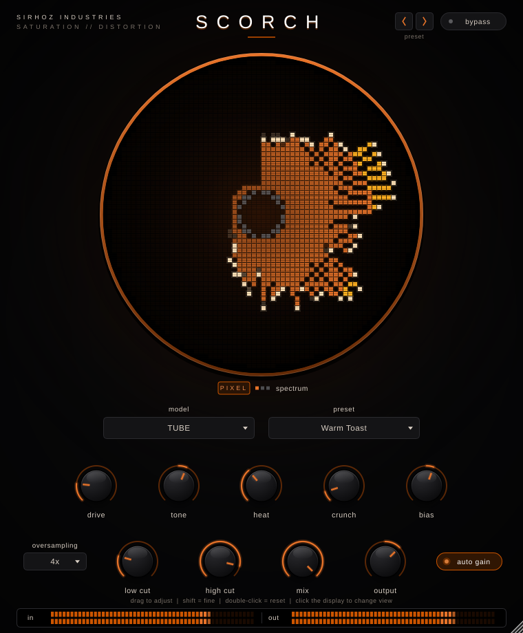
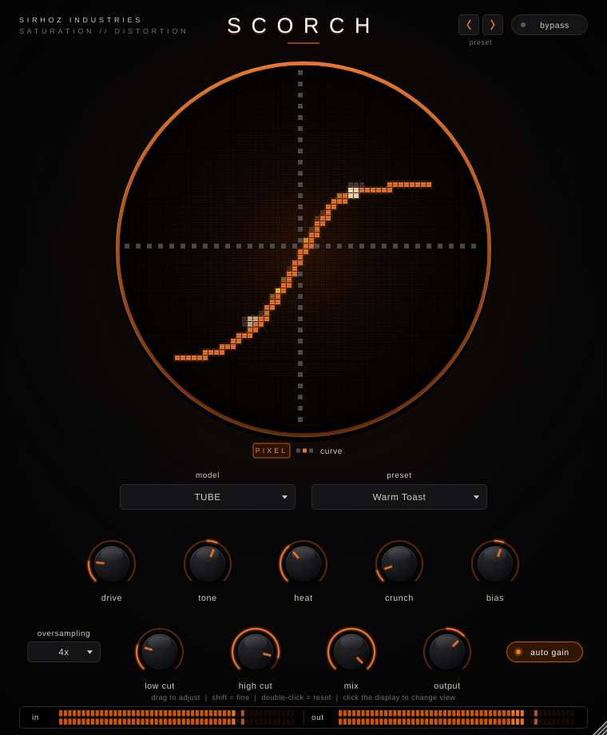
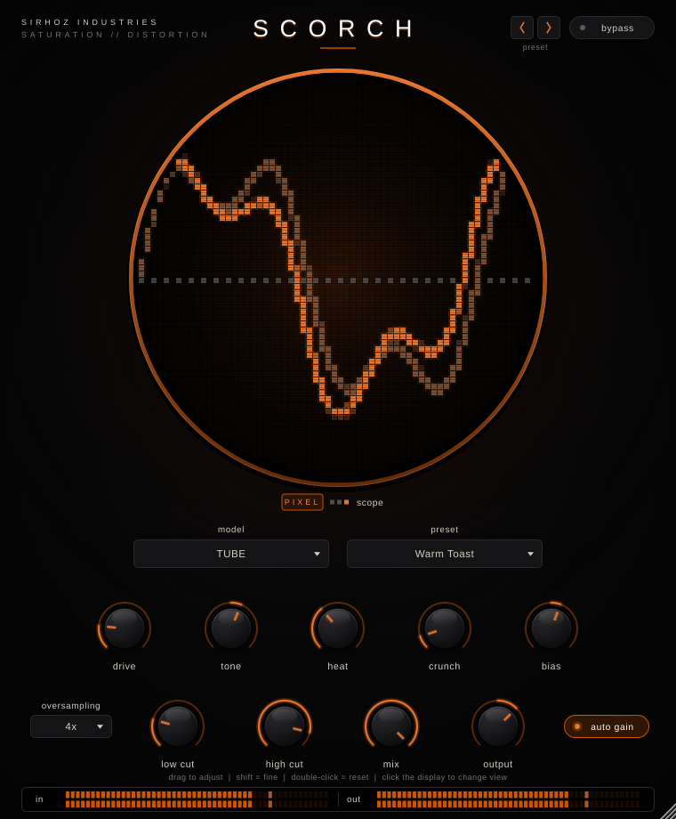

# SCORCH

A saturation and distortion effect by **Sirhoz Industries** that takes a signal from warm to extreme.
It's a JUCE 8 (C++17) VST3 plugin, with a Standalone app as well.
It has a black and dark-orange portrait GUI (760 × 920) with a circular 8-bit pixel display.

| Spectrum | Curve | Scope |
|---|---|---|
|  |  |  |

## Architecture

```
input ─┬────────────── dry delay (= oversampler latency) ───────────────┐
       └─ LOW CUT ─ CRUNCH pre-emphasis ─▶ upsample ─▶ saturator ─▶ downsample
                                           1/2/4/8x    DRIVE·HEAT·BIAS·model
          ◀─ DC blocker ◀─ HIGH CUT ◀─ TONE tilt ◀─ CRUNCH de-emphasis ◀───┘
          └─ auto gain ─▶ MIX (with delayed dry) ─▶ OUTPUT ─▶ bypass crossfade ─▶ out
                                   meters (atomics) + lock-free FIFO ─▶ GUI
```

- **Block handling:** audio is processed in fixed 256-sample chunks, so any host block size works. Nothing is allocated after `prepareToPlay`.
- **Oversampling:** all four factors are built up front, using FIR half-band filters with integer latency. The latency is reported to the host, and the dry path is delayed by the same amount.
- **Models:** TUBE (asymmetric, even harmonics), TAPE (soft clipping with hysteresis memory and HF roll-off), TRANSISTOR (hard symmetric clipping, odd harmonics), FUZZ (rectified clipping with a gate) and FRY (wavefolder plus bit reduction). Switching models crossfades over 12 ms.
- **Auto gain:** a slow RMS follower matches the output level to the input level.
- **GUI:** everything is drawn in code in a 760 × 920 view that scales with a fixed aspect ratio.
- **Pixel display:** a 64 × 64 grid clipped to a circle. It has three views:
  - a radial spectrum (2048-point Hann FFT) with peak-hold pixels
  - the transfer curve, with a live-level dot
  - a dry versus fried oscilloscope

  Click the display, or the PIXEL tag under it, to switch views.
- **Knobs:** drag vertically (Shift for fine), use the mouse wheel, or double-click to reset. A value tooltip appears while you drag.

## Files

```
scorch/
├── CMakeLists.txt              JUCE 8 via FetchContent, VST3 + Standalone, static MSVC runtime
├── Source/
│   ├── Identity.h              names; manufacturer comes from SCORCH_MANUFACTURER in CMake
│   ├── Parameters.h/.cpp       parameters (with units) and factory presets
│   ├── PluginProcessor.h/.cpp  signal flow, latency, presets, state
│   ├── PluginEditor.h/.cpp     portrait layout, header, display rim, dropdowns, knob rows, footer
│   ├── dsp/                    SaturationEngine, Oversampler, Filters, VisualizerFifo
│   └── gui/                    Palette, ScorchLookAndFeel, Knob, LevelMeter, PixelVisualizer
├── Tests/ScorchTests.cpp       offline DSP checks + GUI snapshots
└── docs/                       screenshots
.github/workflows/scorch-build.yml   Windows + macOS VST3 build → artifacts
```

## Build

```bash
cmake -S scorch -B scorch/build -DCMAKE_BUILD_TYPE=Release
cmake --build scorch/build --config Release --target SCORCH_VST3 SCORCH_Standalone
```

The VST3 is written to `scorch/build/SCORCH_artefacts/Release/VST3/SCORCH.vst3`.
On Windows, copy that folder into `C:\Program Files\Common Files\VST3\`.

To run the tests, configure with `-DSCORCH_BUILD_TESTS=ON`, then run `ScorchTests shots`.
